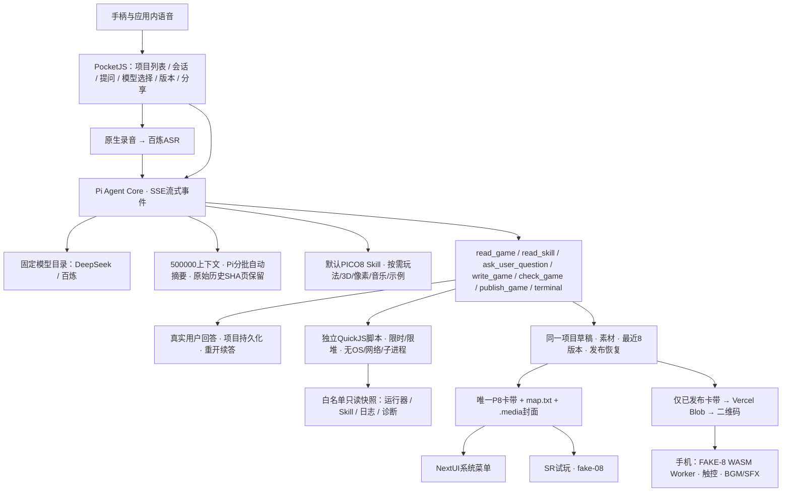

# PocketJS AI 游戏工坊：产品约定与第一版范围

记录日期：2026-10-02。当前实现为Pi 0.81.1 + PocketJS/QuickJS + native C，运行在TrimUI Brick，通过SSH部署。项目列表、直接语音、真实工具循环、流式输出、持续修改与发布恢复均已接通。最新能力与实际目录/按键以[工坊说明](../ports/pocketjs-brick/workshop/README.md)为准；下文保留早期产品探索，拟定映射不代表当前实现。

`write_game`使用完整源码或原版Pi编辑匹配算法；格式检查后才发布。宿主默认创建可试玩第0版脚手架。Agent可讨论玩法、等待真实回答、运行隔离的辅助JS脚本，并读取用户授权的白名单系统快照；不能自动证明游戏玩法正确、读取任意文件或执行Linux shell。界面仅排版可见文本，历史和显示缓存分离。

## 已确定方向

- 平台：运行 NextUI 的 TrimUI Brick，编排和文件管理留在掌机，生成/语音识别调用云端 API。
- 游戏工坊界面使用 PocketJS，按方向键与 A/B/X/Y 操作；不以终端作为用户界面。
- 一个项目对应一个游戏、一个可持续恢复的会话，以及一个固定的当前游戏入口。
- 第一版优先生成 PICO-8 文本卡带，复用 fake-08 / NextUI P8 的构建和启动路径。
- 第一版做产物格式检查和用户试玩。自动玩法测试不作为交付前置条件。
- 内置一份针对 DeepSeek Flash 的游戏开发 Skill 和素材目录：[`skills/pico8-game-dev/SKILL.md`](../skills/pico8-game-dev/SKILL.md)。

## 首要交互

入口是项目列表：显示标题、最近修改时间、是否已有可试玩版本。方向键选择，A 打开，X 新建，B 返回。新建时通过语音描述玩法，由宿主分配稳定项目 ID。

打开项目后，显示当前游戏标题、玩法摘要、最新一次需求/回复和状态。完整会话与版本历史作为次级页面。

| 项目页按键 | 行为 |
| --- | --- |
| 方向键 | 选择与滚动，焦点始终可见 |
| 按住 A | 录音；松开结束并显示识别结果 |
| A（识别结果页） | 提交这次需求 |
| B | 返回或取消当前输入；生成中先显示取消选项 |
| X | 试玩当前完整版本；生成期间仍保留旧版本 |
| Y | 查看会话、修改记录与版本恢复 |
| MENU | 使用一致的退出路径，记录任务状态与当前产物 |

这是一份拟定映射，实际 PocketJS 输入适配需真机确认。工坊按键与游戏内 O/X 两个动作键分别由各自运行器处理。

状态用真实阶段表达：录音、识别、生成、写入草稿、格式已检查、等待试玩、失败/取消。不展示无依据的百分比，也不把生成完毕显示成“测试通过”。生成期间页面保持可操作，取消应能中止实际网络/后台任务。

试玩从工坊启动游戏运行器，回来恢复当前项目；在普通 NextUI 游戏目录中也保留同一个入口。中断或断电恢复需要保留提交阶段和候选文件，不能把残缺响应作为新版本。细节见 [项目契约](../skills/pico8-game-dev/references/project-contract.md)。

## 三种游戏运行方向

| 路线 | 适合解决的问题 | 需要承担的工作 |
| --- | --- | --- |
| PICO-8 / fake-08 | 统一的小型像素游戏规格、Lua、卡带产物；已具备仓库集成路线 | 安装运行包、限定兼容 API、输入/退出及生成游戏真机试玩 |
| SDL2 + Lua 小型运行器 | 原生分辨率、中文、更多按键或定制资源格式 | 我们维护游戏循环、脚本 API、素材/音频、碰撞辅助与资源限制 |
| HTML + WebView | 已有 Web 游戏和 Canvas/浏览器 API | 移植浏览器引擎与显示后端，再处理按键、退出、音频和内存 |

SDL 提供底层图形、音频和输入，不会自动变成完整游戏创作约定；LÖVE 是已有的 Lua 2D 框架，raylib 也是可研究的游戏图形库。这些项目支持 Linux，仍不能等同于直接支持 Brick 的系统库和 Mali 显示环境。第一版沿用 PICO-8，只有出现具体限制时再增加新的运行格式。

PocketJS 官方说明其原生运行时没有 DOM、CSS 引擎或 WebView。HTML 方向需要另接浏览器；WPE WebKit 是嵌入式浏览器候选，但仓库尚无对应接线。HTML 不会自动提高生成游戏的正确性，浏览器本身也增加适配工作。

官方来源：[PICO-8](https://www.lexaloffle.com/pico-8.php)、[fake-08](https://github.com/jtothebell/fake-08)、[PocketJS](https://github.com/pocket-nexus/pocketjs)、[SDL](https://www.libsdl.org/)、[LÖVE](https://love2d.org/)、[raylib](https://github.com/raysan5/raylib)、[WPE WebKit](https://wpewebkit.org/about/)。

## Agent 的复用边界

现成框架可提供工具循环与事件，但项目身份、游戏版本、会话恢复、试玩和手柄操作由产品层定义。前端/agent 只能操作指定项目，发布由确定性的宿主逻辑执行。

新发现的 [PocketPi](https://github.com/pocket-nexus/pocket-pi) 已把 Pi agent harness 接到 PocketJS/QuickJS，值得作为优先研究对象。其已验证硬件为 ESP32-P4/S3，尚无 Brick 的支持证据；官方 [当前边界](https://pi.pocketlab.build/docs/current-boundaries) 明确会话重启恢复和持久版本回滚等功能仍有缺口。

本地锁定的 PocketJS 原生 UI 核心已真机通过，TypeScript/QuickJS 仍待接入。PocketPi 使用另一套固定 PocketJS 版本，需要单独验证，不能直接拼接两套构建。现有 Voice AI 的录音、ASR 与流式显示可复用，但其短答缓冲、工具调用、取消和文件产物管理仍需扩展。

## 当前可交付与后续实现

当前交付是开发 Skill、API/项目参考、原创像素素材与离线卡带组装器。它们不修改 NextUI 系统文件，不代表游戏工坊已开发完成。

后续先完成 PocketJS 最小中文项目页、文件/异步网络桥接和稳定按键，再接入固定项目的生成/修改。首个实际验收是：语音创建游戏，生成完整产物，进入固定目录，试玩后回来修改同一游戏，重启工坊后项目与会话仍在。
